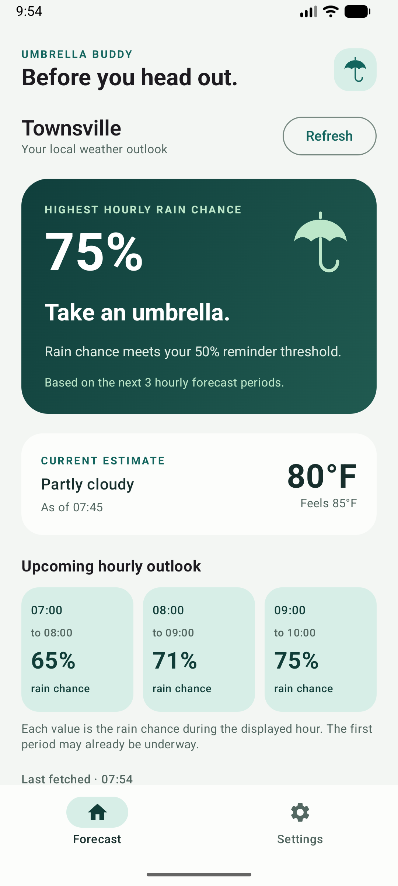
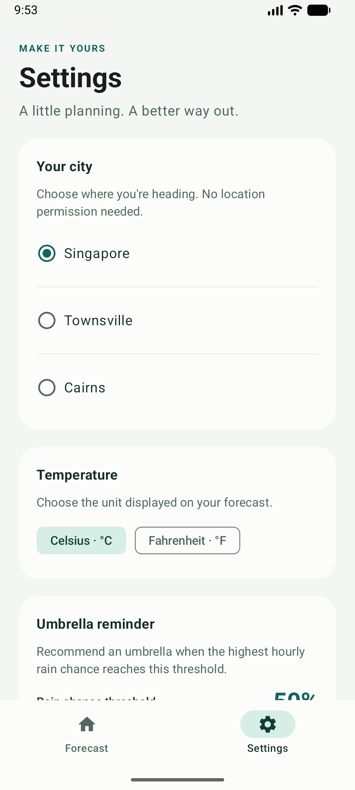
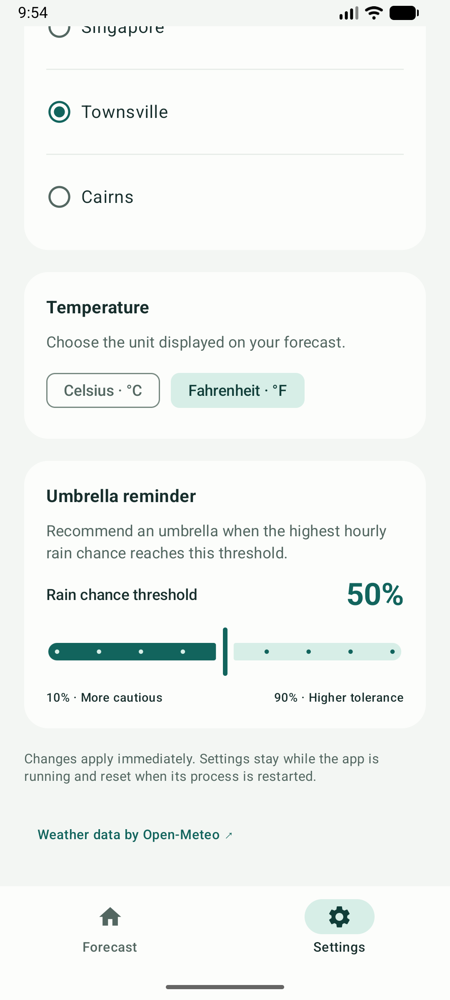

# Umbrella Buddy

An Android utility app that helps answer one daily question: **should I bring an umbrella before heading out?**

The forecast screen puts the highest upcoming hourly rain probability and a clear recommendation first. Settings control the selected city, temperature unit and rain threshold. Built for CP3406 / CP5307 Assessment 1 using the lecturer's Kotlin, Jetpack Compose and Material Design 3 starter.

## Features

- Live current temperature, apparent temperature and weather description from Open-Meteo.
- Three upcoming hourly rain-probability cards with explicit local start/end times.
- An umbrella recommendation when the highest valid hourly probability is **at least** the chosen threshold (default 50%).
- Preset cities: Singapore, Townsville and Cairns.
- Celsius/Fahrenheit switching without an extra network request.
- Adjustable reminder threshold from 10% to 90%, in 10-point steps.
- Loading, refresh, service-error and retry states; clear notices when showing saved or stale data.
- Light and dark themes, scrollable layouts, scalable typography and accessible Material controls.
- Settings shared between tabs and retained across activity recreation. Permanent settings storage is intentionally outside this assignment's scope.

## Screenshots

<p>
  
  
  
</p>

These are running-app screenshots with live weather. Values vary with the selected city and fetch time. A lower-rain-risk Singapore example is also available in `docs/screenshots/forecast.png`.

## Run the project

1. Clone this repository and open its root folder in Android Studio (the folder containing `settings.gradle.kts`).
2. Let Gradle sync. The starter uses Gradle 8.13, Android Gradle Plugin 8.13.2, Kotlin 2.0.21 and an automatically provisioned JetBrains JDK 21.
3. Install Android SDK Platform 36 if Android Studio requests it. Minimum supported Android version is API 26.
4. Start an emulator or connect an Android device, then run the `app` configuration.
5. Internet access is required for live weather. No API key, user account or location permission is needed.

Android Studio creates `local.properties` for your SDK path. Do not commit a machine-specific SDK path or generated build/cache files.

## Implementation

| Requirement | Implementation |
| --- | --- |
| Kotlin / modern Android | Single activity, coroutines, lifecycle-aware state collection and `java.time` on API 26+. |
| Jetpack Compose / Material 3 | Two-tab scaffold, reusable forecast/settings cards, slider, chips, radio controls and custom Canvas umbrella artwork. |
| ViewModel | `WeatherViewModel` owns loading, errors, the latest weather and shared preferences in a `StateFlow`. |
| Repository | `WeatherRepository` separates the UI from data access; `NetworkWeatherRepository` maps and validates network responses. |
| Dependency injection | An application-scoped `AppContainer` constructs dependencies and passes the repository and clock to the ViewModel factory. |
| Networking | Retrofit with Gson and a bounded-timeout OkHttp client calls Open-Meteo over HTTPS. |
| Settings affect the main screen | City changes fetch a new forecast; units convert the temperature; the threshold changes the umbrella recommendation immediately. |

See [architecture and decision notes](docs/ARCHITECTURE.md) for the data flow and class responsibilities.

## Weather data and decision rule

Endpoint: `https://api.open-meteo.com/v1/forecast`.

The request uses preset coordinates, `current=temperature_2m,apparent_temperature,weather_code`, `hourly=precipitation_probability`, `forecast_days=2`, `timezone=auto` and `timeformat=unixtime`.

Open-Meteo's hourly precipitation probability refers to the **hour preceding its timestamp**. The app selects the next three period end times after the current instant and labels each hour explicitly. The first period can already be underway. The hero shows the maximum individual hourly probability, not a combined probability for the entire window.

If any of the three rain probabilities is missing or invalid, the app says the forecast is incomplete instead of treating missing data as 0%. Data fetched more than 15 minutes ago, or current conditions older than 90 minutes, are labelled stale and do not produce a fresh recommendation. Refresh manually, or return to the app to refresh data older than 10 minutes.

Forecasts are model estimates and can change. A low probability does not guarantee dry weather.

## Tests

```powershell
.\gradlew.bat :app:assembleDebug :app:testDebugUnitTest :app:lintDebug
.\gradlew.bat :app:connectedDebugAndroidTest
```

Unit tests cover the umbrella boundary, unknown data, midnight/timezone handling, unit conversion, stale data, Retrofit JSON mapping, HTTP errors, retries and overlapping city requests. Compose tests run on an emulator and cover navigation, settings updates, missing-data presentation and retry interaction.

See the [verification guide](docs/TESTING.md) for the test groups and manual walkthrough.

## Scope and limitations

- Two screens only; no map, automatic location, push notifications or background weather service.
- Three preset cities; settings reset after the app process is restarted.
- No disk cache. Saved weather shown after a failed refresh is held only in the current ViewModel.
- API availability and the device clock affect the forecast. No fabricated weather is used when production requests fail.

## Attribution

- Project scaffold and initial navigation/theme structure: the CP3406 / CP5307 lecturer-provided **MobileTech Utility App** starter.
- Weather data: [Open-Meteo](https://open-meteo.com/) ([API documentation](https://open-meteo.com/en/docs)); attribution is also linked in the app.
- Architectural references: [Android manual DI](https://developer.android.com/training/dependency-injection/manual) and [ViewModels with dependencies](https://developer.android.com/topic/libraries/architecture/viewmodel/viewmodel-factories).
- Networking library: [Retrofit](https://github.com/square/retrofit).
