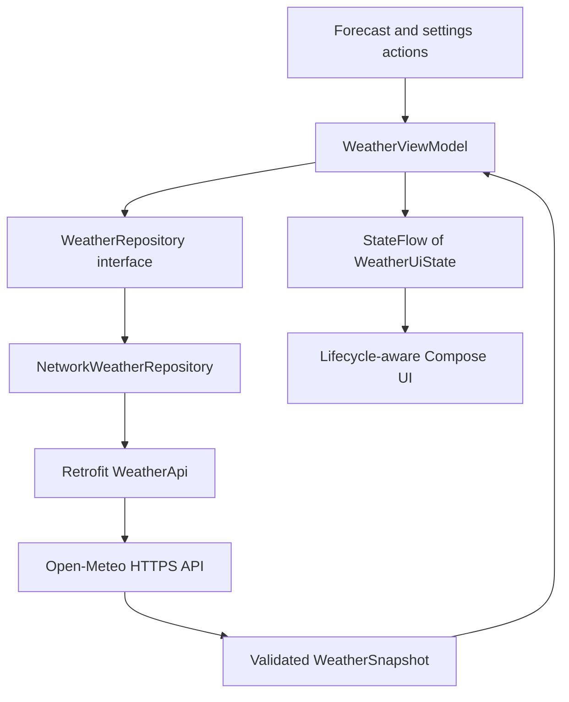

# How Umbrella Buddy works

The app extends the lecturer's single-activity starter. Its two bottom-navigation destinations are Forecast and Settings.

## Responsibilities

| File | Responsibility |
| --- | --- |
| `MainActivity.kt` | Resolve the injected ViewModel, observe state with the lifecycle, and host the starter's two-tab scaffold. |
| `UmbrellaApplication.kt` | Application-scoped dependency container: clock, HTTP client, Retrofit API and repository. |
| `data/WeatherApi.kt` | Typed HTTP endpoint and nullable JSON transfer objects. |
| `data/WeatherRepository.kt` | Fetch and validate API data; map timestamps, units and optional fields into the app model. |
| `model/Weather.kt` | Cities, preferences, temperature conversion, stale-data detection and umbrella decision rules. |
| `ui/WeatherViewModel.kt` | Shared state, request cancellation, retries, settings updates and lifecycle refresh. |
| `ui/WeatherScreens.kt` | Stateless, reusable screen/card components and an umbrella illustration drawn with Compose Canvas. |

## Important decisions

- **Manual dependency injection:** dependencies are passed through constructors and a ViewModel factory. No global repository lookup occurs inside individual UI cards. This follows Android's small-app container approach without adding a DI framework.
- **State lifetime:** one activity-scoped ViewModel is shared by both tabs. Settings and weather survive tab switching and activity recreation, but are intentionally not persisted after process death. The selected tab uses `rememberSaveable`.
- **One temperature source:** the API returns Celsius. Fahrenheit is calculated locally, so changing units is instant and does not need another network request.
- **City changes:** cancel the old request and clear old-city data before fetching the new city. A request ID also prevents late results from replacing newer state.
- **Time zones:** requests use Unix timestamps and `timezone=auto`. Dates are formatted using the returned `ZoneId`, including across midnight and daylight-saving changes.
- **Rain periods:** Open-Meteo describes `precipitation_probability` as the probability for the hour preceding a timestamp. The app selects the next three period end times strictly after the current instant and displays each start/end pair. The first period may already be in progress. It does not present the maximum as a combined probability of rain across all three hours.
- **Incomplete data:** null, missing and out-of-range probabilities are unknown, not zero. The main recommendation is withheld unless all three periods have valid data.
- **Stale data:** data fetched over 15 minutes ago, or current conditions older than 90 minutes, are labelled stale and do not generate a fresh umbrella recommendation. A minute tick updates this state. Returning to the app refreshes data older than 10 minutes; manual Refresh is always available when idle.
- **Network errors:** show a retry message. If a same-city forecast was already loaded, keep it visible with an explicit saved-forecast/error notice. Requests have bounded connection, read and overall timeouts.
- **Scope:** preset cities avoid location permissions, accounts and API keys. Only INTERNET permission is requested.

## References

- [Open-Meteo API and variable semantics](https://open-meteo.com/en/docs)
- [Manual dependency injection](https://developer.android.com/training/dependency-injection/manual)
- [Create ViewModels with dependencies](https://developer.android.com/topic/libraries/architecture/viewmodel/viewmodel-factories)
- [Retrofit source and documentation](https://github.com/square/retrofit)
